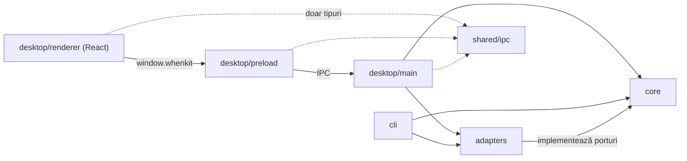
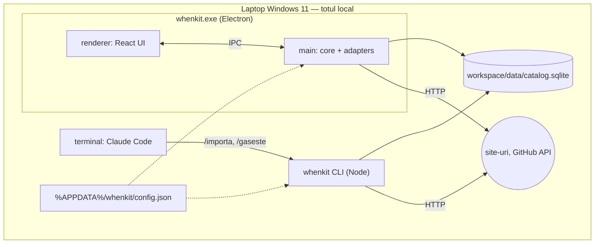
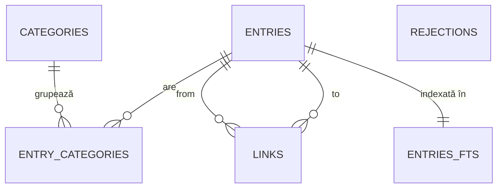

# Architecture Spine — whenkit

## Design Paradigm

**Hexagonal ușor (ports & adapters).** `core` conține toată logica (fișe, verificare, import, căutare, export) și definește **porturi** (interfețe) pentru tot ce ține de lumea exterioară. `adapters` implementează porturile. `cli` și `desktop` sunt **drivere subțiri**: traduc o comandă sau un click într-un apel de caz de utilizare din `core`.

| Strat | Director | Conține |
|---|---|---|
| Nucleu | `src/core/` | entități, schema Zod a lotului, cazuri de utilizare, reguli de verificare, porturi |
| Adaptoare | `src/adapters/` | SQLite (`node:sqlite`), HTTP, GitHub API, sistem de fișiere, mediu/config |
| Driver CLI | `src/cli/` | comenzile `whenkit` |
| Driver desktop | `src/desktop/main/`, `src/desktop/preload/`, `src/desktop/renderer/` | procesul main Electron, puntea IPC, interfața React |
| Contract IPC | `src/shared/ipc.ts` | tipurile canalelor IPC, importate de main, preload și renderer |



Săgeata înseamnă „poate importa”. `core` nu importă nimic din afara lui (în afară de Zod).

## Invariants & Rules

### AD-1 — Stack: Electron + TypeScript + React, un singur limbaj [ADOPTED]

- **Binds:** all
- **Prevents:** logică scrisă de două ori în limbaje diferite pentru CLI și UI.
- **Rule:** Tot codul e TypeScript. UI-ul e React în renderer-ul Electron, iar CLI-ul și main-ul rulează același `core` pe Node ≥ 24.

### AD-2 — `core` este pur

- **Binds:** all
- **Prevents:** CLI dependent de Electron; verificare netestabilă fără internet; logică amestecată cu I/O.
- **Rule:** `src/core/` nu importă `electron`, `react`, `node:fs`, `node:sqlite`, `fetch` sau rețea. Orice efect exterior trece printr-un port definit în `src/core/ports.ts` (`CatalogStore`, `HttpClient`, `GitHubClient`, `Clock`, `IdGenerator`, `FileSystem`, `Environment`). Adaptoarele se injectează la pornire de `cli` sau `desktop/main`.

### AD-3 — Un singur drum de scriere în catalog

- **Binds:** CAP-2, CAP-4, CAP-10, CAP-11, CAP-13
- **Prevents:** două locuri care scriu aceleași date cu reguli diferite; ocolirea verificării.
- **Rule:** Doar cazurile de utilizare din `core` scriu în SQLite, prin `CatalogStore`. CLI-ul și main-ul le apelează. Renderer-ul nu are acces la date decât prin IPC. Skill-urile Claude nu scriu niciodată în `data/`: adaugă și modifică doar prin `whenkit import`.

### AD-4 — Stocare: SQLite prin `node:sqlite` [ADOPTED]

- **Binds:** CAP-2, CAP-8, CAP-9, CAP-10, CAP-11, CAP-13
- **Prevents:** module native compilate diferit pentru Electron și Node (`NODE_MODULE_VERSION mismatch`); scrieri concurente care se suprascriu.
- **Rule:** Catalogul e un fișier SQLite în `<workspace>/data/`. Se deschide doar prin adaptorul `SqliteCatalogStore`, care setează `journal_mode=WAL` și `busy_timeout`, rulează migrările ținute în `PRAGMA user_version` într-o tranzacție și refuză o bază mai nouă decât codul. Nicio altă bibliotecă SQLite.

### AD-5 — Modelul de date

- **Binds:** CAP-2, CAP-7, CAP-8, CAP-9, CAP-10, CAP-11, CAP-13
- **Prevents:** relații modelate diferit de module diferite; redenumiri care nu se propagă.
- **Rule:** Schema din *Structural Seed*. Id-uri UUID generate în `core` (`IdGenerator`). Fișele referă categoriile prin id. Listele (`situations`, `keywords`, `sources`) se stochează ca JSON, validate de Zod. Toate legăturile stau într-un singur tabel `links` cu `type ∈ {related, parent}`: `related` e simetric (un rând, interogat în ambele sensuri), `parent` merge de la umbrelă la copil. Ștergerea unei fișe șterge legăturile ei (cascade). Fiecare fișă are `owner_id`, cu o singură valoare, ținută în tabelul `meta` și creată la prima deschidere a catalogului. Nici CLI-ul, nici aplicația nu generează alta.

### AD-6 — Contractul lotului de import: o singură schemă Zod

- **Binds:** CAP-2, CAP-6, CAP-7
- **Prevents:** skill-ul și codul care înțeleg diferit formatul lotului.
- **Rule:** Schema lotului e definită o singură dată în `src/core/batch-schema.ts`, cu `schemaVersion` obligatoriu. Din ea derivă validarea din `whenkit import` și fișierul JSON Schema (`z.toJSONSchema`, Draft 2020-12), pe care `whenkit init` îl copiază în workspace pentru `/importa`. Fiecare element are `op ∈ {add, update}`. Un `update` cere `id`, trece prin verificare și nu atinge niciodată `myNotes`, `ownerId` și `addedAt`. Un lot invalid față de schemă nu scrie nimic (o singură tranzacție). Referințe în lot:
- **categoriile**, prin nume, în zona fișei; cele noi se declară în `newCategories`, iar o categorie necunoscută și nedeclarată respinge elementul;
- **legăturile** (`related`, `parent`), prin `id`-ul unei fișe existente sau prin `ref`-ul local al altui element din același lot (fiecare element are un `ref` unic în lot);
- o legătură către un element respins se ignoră și apare în raport.

### AD-7 — Verificarea: modul determinist, cu verdicte ca valori

- **Binds:** CAP-3, CAP-4, CAP-5
- **Prevents:** reguli de verificare duplicate sau divergente între import și re-verificarea viitoare; rezultate diferite la rulări diferite.
- **Rule:** Verificarea trăiește în `src/core/verification/`. Primește un candidat sau o fișă existentă și întoarce un verdict `{ outcome: accepted | warned | rejected | duplicate, reasons[] }`; nu aruncă excepții pentru rezultate de verificare. Reguli de link:

| Rezultat HTTP | Verdict |
|---|---|
| 2xx, 3xx (după redirect) | accepted |
| 401, 403, 429 | accepted + notă „blochează accesul automat” |
| 5xx, timeout 10 s | 2 reîncercări, apoi warned („nu a răspuns la import”) |
| 404, 410, DNS inexistent, certificat SSL invalid, URL invalid sintactic | rejected |
| domeniu din `blocked-domains.txt` | rejected |
| duplicat | duplicate (ignorat + mesaj) |

`HEAD` întâi, `GET` dacă `HEAD` nu e acceptat; User-Agent de browser. Duplicat = URL normalizat (host lowercase, fără `www.`, fără fragment, fără slash final, fără `utm_*`) pentru unealtă/material, titlu normalizat (lowercase, fără diacritice) pentru concept; normalizarea există doar în `core`. Duplicatul se detectează și în interiorul aceluiași lot. O intrare din jurnalul de respinse se elimină când URL-ul ei normalizat e acceptat sau forțat. Verdictul de conținut dubios vine de la Claude în lot și duce la rejected. `--force` transformă rejected în accepted cu notă „verificare ocolită de utilizator”.

### AD-8 — Rezolvarea workspace-ului: o singură funcție

- **Binds:** CAP-1, CAP-2, CAP-12, toate ecranele
- **Prevents:** CLI-ul și aplicația care lucrează pe baze de date diferite.
- **Rule:** `resolveWorkspace()` din `core` (prin portul `Environment`/`FileSystem`) e singura sursă a căii. Ordinea: variabila `WHENKIT_WORKSPACE` → `%APPDATA%\whenkit\config.json` (scris de `whenkit init`) → eroare „rulează `whenkit init`”. Nicio valoare implicită ascunsă. `whenkit init` refuză o cale aflată în interiorul repo-ului whenkit.

### AD-9 — Securitatea ferestrei Electron

- **Binds:** CAP-8, CAP-10, CAP-13
- **Prevents:** un link din catalog care deschide un site străin în fereastra cu acces la disc; cod din renderer cu acces la Node.
- **Rule:** `contextIsolation: true`, `nodeIntegration: false`, `sandbox: true`, CSP fără surse externe. Preload expune doar `window.whenkit`, un API tipat după `src/shared/ipc.ts`. Linkurile se deschid în browserul implicit prin `shell.openExternal`, doar pentru `http:`/`https:`. Fereastra blochează orice navigare și `window.open` externe.

### AD-10 — Fereastra vede scrierile CLI-ului

- **Binds:** CAP-2, CAP-8
- **Prevents:** UI care afișează date vechi după un import din terminal; watchers de fișiere instabili.
- **Rule:** Main-ul citește periodic (la câteva secunde) `PRAGMA data_version` și, la schimbare, emite `catalog:changed`. Renderer-ul reîncarcă datele afișate. Nu se folosesc watchers pe fișiere.

### AD-11 — Interfața CLI e un contract pentru skill-uri

- **Binds:** CAP-1, CAP-2, CAP-4, CAP-6, CAP-12
- **Prevents:** skill-uri care parsează text de om și se strică la o reformulare.
- **Rule:** Comenzi v1: `whenkit init`, `whenkit import <lot> [--json] [--force <id>]`, `whenkit list --json`, `whenkit categories --json`, `whenkit rejections --json`. Cu `--json`, ieșirea pe stdout e JSON stabil (camelCase, cu `schemaVersion`). Coduri de ieșire: `0` = lot procesat (chiar cu respingeri), `1` = lot invalid, nimic scris, `2` = configurare lipsă. Comenzile de citire nu scriu niciodată.

### AD-12 — Exportul: JSON complet + Markdown

- **Binds:** CAP-13
- **Prevents:** un export care pierde câmpuri sau nu poate fi refolosit.
- **Rule:** Exportul scrie un folder `whenkit-export-<dată>/` cu `catalog.json` (toate fișele, categoriile, legăturile, notițele, `schemaVersion`) și `fise/<slug>.md` (frontmatter + conținut, legături între fișe compatibile Obsidian). Exportul e un caz de utilizare din `core` care doar citește.

### AD-13 — Limba [ADOPTED]

- **Binds:** all
- **Prevents:** cod de tradus la open-source; texte UI împrăștiate.
- **Rule:** Codul e integral în engleză (identificatori, comentarii, mesaje de commit). Textele UI stau doar în `src/desktop/renderer/strings.ro.ts`. Conținutul fișelor e în română, scris de Claude; aplicația nu traduce.

## Consistency Conventions

| Concern | Convention |
| --- | --- |
| Denumiri | fișiere `kebab-case`; tipuri și componente `PascalCase`; funcții `camelCase`; coloane SQL `snake_case`; canale IPC `domeniu:acțiune` (`entries:list`, `categories:rename`, `catalog:export`, `catalog:changed`) |
| Formate | JSON extern (lot, export, IPC, `--json`) în `camelCase`; date ISO 8601 UTC; id UUID v4 (`crypto.randomUUID()`); fiecare format persistent sau extern are `schemaVersion` |
| Mapare | conversia `snake_case` ↔ `camelCase` doar în `SqliteCatalogStore` |
| Erori | `core` aruncă `WhenkitError { code, message }` pentru erori de program/configurare; verdictele de verificare sunt valori (AD-7); CLI-ul traduce în coduri de ieșire (AD-11) |
| Configurare | doar prin `resolveWorkspace()` (AD-8); fără chei API în v1 |
| Teste | Vitest; `core` testat cu adaptoare false; `SqliteCatalogStore` testat pe `:memory:`; scenariile din `test-scenarios.md` sunt teste de verificare |
| Categorii | semănate de `whenkit init` din `categories-seed.md`; o categorie nouă intră doar declarată explicit în lot |
| Domenii interzise | `<workspace>/data/blocked-domains.txt`, o regulă pe linie; `libgen.*` = orice TLD; subdomeniile incluse |

## Stack

| Name | Version |
| --- | --- |
| Electron | 44.7.0 (Node 24.21.0, SQLite 3.53.4) |
| Node.js (CLI, dezvoltare) | ≥ 24 (local 24.19.0) |
| @electron-forge/cli | 8.0.1 |
| @electron-forge/plugin-vite | 8.0.1 |
| Template Forge | vite-typescript 7.11.2 |
| TypeScript | fixat de template |
| Vite | fixat de template |
| React | 19.3.0 |
| Zod | 4.6.7 |
| Vitest | 5.0.4 |
| SQLite driver | `node:sqlite` (inclus în Node/Electron) |

## Structural Seed





Coloane `entries`: `id`, `owner_id`, `kind` (tool/material/concept), `name`, `url`, `resource_type`, `what_it_does`, `situations` (JSON), `keywords` (JSON), `sources` (JSON), `content`, `my_notes`, `github_stars`, `github_last_commit`, `github_archived`, `verification_note`, `forced`, `added_at`, `verified_at`. `entries_fts`: FTS5 cu `tokenize='unicode61 remove_diacritics 2'` peste `name`, `what_it_does`, `situations`, `keywords`, `content`, `my_notes`, întreținut de `SqliteCatalogStore`.

```text
whenkit/
  src/
    core/              # entități, batch-schema, use cases, verification/, ports.ts
    adapters/          # sqlite/, http/, github/, fs/, env/
    cli/               # intrarea whenkit (bin)
    shared/            # ipc.ts
    desktop/
      main/            # fereastra, handleri IPC, polling data_version
      preload/         # window.whenkit
      renderer/        # React, strings.ro.ts
  workspace-template/  # CLAUDE.md runtime, .claude/skills/importa|gaseste, reguli, blocked-domains.txt
  tests/               # fixture-uri pentru scenariile de verificare
```

`workspace-template/` e sursa versionată a workspace-ului; `whenkit init` o copiază, adaugă JSON Schema a lotului și semănă categoriile.

## Capability → Architecture Map

| Capability / Area | Lives in | Governed by |
| --- | --- | --- |
| CAP-1 init workspace | `cli` + `core` (init) + `workspace-template/` | AD-6, AD-8, AD-11 |
| CAP-2 import lot | `core` (import use case) + `cli` | AD-3, AD-6, AD-7, AD-11 |
| CAP-3 verificare | `core/verification` + `adapters/http` | AD-2, AD-7 |
| CAP-4 jurnal respinse, --force | `core` + tabel `rejections` | AD-5, AD-7, AD-11 |
| CAP-5 metadate GitHub | `adapters/github` prin port `GitHubClient` | AD-2, AD-7 |
| CAP-6 /importa | `workspace-template/.claude/skills/importa` | AD-3, AD-6, AD-11 |
| CAP-7 concepte + umbrelă | `core` (schema, links `parent`) | AD-5, AD-6 |
| CAP-8 navigare | `desktop/renderer` → IPC → `core` | AD-3, AD-9, AD-10 |
| CAP-9 căutare text | `adapters/sqlite` (FTS5) prin `CatalogStore` | AD-4, AD-5 |
| CAP-10 fișa, editare, Notițele mele | `desktop/renderer` → `core` | AD-3, AD-5, AD-6 |
| CAP-11 categorii | `core` + `desktop/renderer` | AD-5 |
| CAP-12 /gaseste | `workspace-template/.claude/skills/gaseste` + `whenkit list --json` | AD-11 |
| CAP-13 export | `core` (export use case) + `desktop/main` | AD-12 |

## Deferred

- **Rularea CLI-ului prin executabilul Electron** (`ELECTRON_RUN_AS_NODE`), ca să nu ceară Node instalat: necesar doar la distribuția open-source.
- **Installer, semnarea codului, auto-update:** `npm run make` din Forge ajunge pentru uz personal.
- **CI, logare structurată, telemetrie:** nu există server și nici alți utilizatori.
- **Restore din export:** `catalog.json` îl face posibil; nu e cerut în v1.
- **Re-verificare, ecran Setări, câmp Status:** `post-v1-roadmap.md`; AD-7 permite deja verificarea unei fișe existente.
- **Butoane Claude headless și terminal integrat** (xterm.js + node-pty): după v1; AD-1 și AD-9 le permit, iar procesele se pornesc doar din `main`.
- **Structura componentelor React, rutarea, librăria de stil:** decizii locale ale tichetelor de UI, fără risc de divergență între unități.
- **Compatibilitatea template-ului Forge (vite-typescript 7.11.2) cu Forge CLI 8.0.1:** se verifică la crearea proiectului, în primul tichet.
- **Detaliile exacte ale câmpurilor din lot:** urmează câmpurile din `entry-model.md`; le fixează primul tichet care scrie `batch-schema.ts`, sub AD-6.
