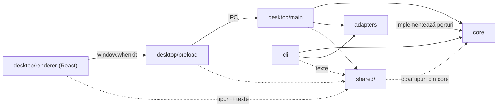
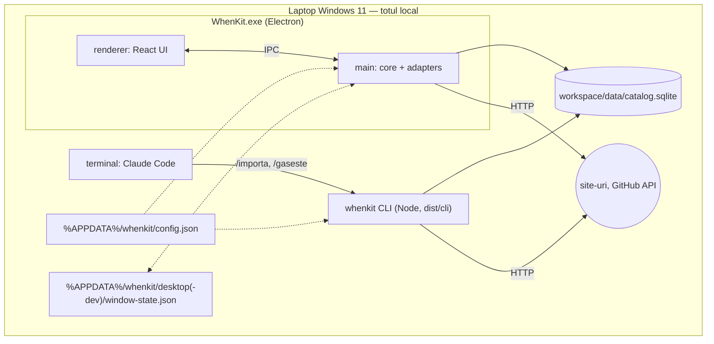
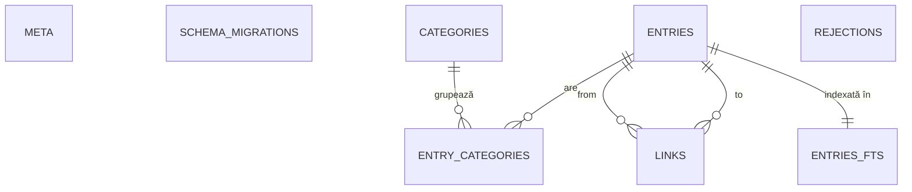

# Architecture Spine — whenkit

## Design Paradigm

**Hexagonal ușor (ports & adapters).** `core` conține toată logica (fișe, verificare, import, căutare, export) și definește **porturi** (interfețe) pentru tot ce ține de lumea exterioară. `adapters` implementează porturile. `cli` și `desktop` sunt **drivere subțiri**: traduc o comandă sau un click într-un apel de caz de utilizare din `core`.

| Strat | Director | Conține |
|---|---|---|
| Nucleu | `src/core/` | entități, scheme Zod (lot, raport, ieșiri CLI), DTO-uri, cazuri de utilizare, verificare, coduri de motive și erori, porturi |
| Adaptoare | `src/adapters/` | SQLite (`node:sqlite`, migrări), HTTP, GitHub API, sistem de fișiere, mediu/config |
| Driver CLI | `src/cli/` | comenzile `whenkit` |
| Driver desktop | `src/desktop/main/`, `src/desktop/preload/`, `src/desktop/renderer/` | procesul main Electron, puntea IPC, interfața React |
| Partajat | `src/shared/` | `ipc.ts` (tipurile canalelor), `strings.ro.ts` (toate textele românești) |



Săgeata înseamnă „poate importa”. `core` nu importă nimic din afara lui (în afară de Zod). Granițele sunt impuse de oxlint (`no-restricted-imports`) pe `src/core/**` și `src/desktop/renderer/**`.

## Invariants & Rules

### AD-1 — Stack: Electron + TypeScript + React, un singur limbaj [ADOPTED]

- **Binds:** all
- **Prevents:** logică scrisă de două ori în limbaje diferite pentru CLI și UI.
- **Rule:** Tot codul e TypeScript, modul ESM. UI-ul e React în renderer-ul Electron, iar CLI-ul și main-ul rulează același `core` pe Node ≥ 24.

### AD-2 — `core` este pur

- **Binds:** all
- **Prevents:** CLI dependent de Electron; verificare netestabilă fără internet; logică amestecată cu I/O.
- **Rule:** `src/core/` nu importă `electron`, `react`, `node:fs`, `node:sqlite`, `fetch` sau rețea. Orice efect exterior trece printr-un port din `src/core/ports.ts` (`CatalogStore`, `HttpClient`, `GitHubClient`, `Clock`, `IdGenerator`, `FileSystem`, `Environment`). Adaptoarele se injectează la pornire de `cli` sau `desktop/main`. Regula e verificată de oxlint (`no-restricted-imports`).

### AD-3 — Un singur drum de scriere în catalog, cu verificare la orice link

- **Binds:** CAP-2, CAP-4, CAP-10, CAP-11, CAP-13
- **Prevents:** două locuri care scriu aceleași date cu reguli diferite; ocolirea verificării din import sau din UI.
- **Rule:** Doar cazurile de utilizare din `core` scriu în SQLite, prin `CatalogStore`; CLI-ul și main-ul le apelează, renderer-ul ajunge la date doar prin IPC. Skill-urile Claude nu scriu niciodată în `data/`: adaugă și modifică doar prin `whenkit import`. Orice scriere care schimbă `url` sau `sources` — din import sau din UI — trece prin același caz de utilizare de verificare (AD-7); o editare din UI respinsă nu se salvează și își arată motivele. `myNotes` se scrie doar din UI.

### AD-4 — Stocare: SQLite prin `node:sqlite`, migrări sigure [ADOPTED]

- **Binds:** CAP-2, CAP-8, CAP-9, CAP-10, CAP-11, CAP-13
- **Prevents:** module native compilate diferit pentru Electron și Node; scrieri concurente care se suprascriu; migrări divergente din ramuri diferite; pierderea catalogului la o migrare greșită.
- **Rule:** Catalogul e `<workspace>/data/catalog.sqlite`, deschis doar prin `SqliteCatalogStore`, care setează pe fiecare conexiune `journal_mode=WAL`, `foreign_keys=ON` și `busy_timeout` (≤ 2000 ms în main). Migrările sunt fișiere numerotate, append-only, în `src/adapters/sqlite/migrations/NNNN-<nume>.sql`; numărul se fixează la merge în `main`. Tabelul `schema_migrations(version, name, sha256)` ține ce s-a aplicat, iar o nepotrivire oprește deschiderea (`MIGRATION_MISMATCH`). Înainte de orice migrare baza se copiază în `data/backups/catalog-v<N>-<dată>.sqlite`. Migrarea rulează în `BEGIN IMMEDIATE`, iar al doilea proces reverifică versiunea după lock. O bază mai nouă decât codul e refuzată. Migrează doar CLI-ul: main-ul deschide catalogul în modul care scrie fără să migreze (`OpenStoreOptions.migrate: false`), iar migrările în așteptare dau `DATABASE_NEEDS_MIGRATION` înainte de orice pragma care scrie. Nicio altă bibliotecă SQLite.

### AD-5 — Modelul de date

- **Binds:** CAP-2, CAP-4, CAP-7, CAP-8, CAP-9, CAP-10, CAP-11, CAP-13
- **Prevents:** relații modelate diferit de module diferite; redenumiri care nu se propagă; legături dublate; index de căutare desincronizat; categorii amestecate între zone.
- **Rule:** Schema din *Structural Seed*, cu aceste invariante:
  - Id-uri UUID generate în `core` (`IdGenerator`). Fiecare rând are `owner_id`, cu o singură valoare ținută în `meta` și creată la prima deschidere.
  - **Categorii:** unice pe `(owner_id, zone, name_key)`; `name_key` = normalizarea comună (lowercase, fără diacritice, spații comprimate), dintr-o singură funcție din `core`. O fișă are 1–2 categorii, toate din zona felului ei. Unificarea și mutarea sunt permise doar în aceeași zonă. Ștergerea unei categorii care e singura pe o fișă cere o categorie-țintă (devine unificare). Lista de start e o constantă din `core`, generată din `categories-seed.md` și semănată **o singură dată**, de migrarea care creează tabelul.
  - **Legături:** un singur tabel `links` cu `type ∈ {related, parent}`; `related` se stochează canonic (`from_id < to_id`), cu `UNIQUE(type, from_id, to_id)` și `CHECK(from_id <> to_id)`; `parent` leagă doar concept → concept, fără cicluri (verificat în `core`). Ștergerea unei fișe îi șterge legăturile (cascade).
  - **Duplicate:** `core` calculează `dedup_key` (`url:<URL normalizat>` sau `title:<titlu normalizat>` pentru concepte fără link); index unic pe `(owner_id, dedup_key)`.
  - **Concurență:** `entries.revision` crește doar când se schimbă conținutul editabil al fișei: câmpurile scrise de Claude și categoriile ei (`update` din import, `entries:patch`, unificarea sau ștergerea unei categorii, pe fișele afectate). `setNotes` și redenumirea unei categorii nu o schimbă (AD-16).
  - **Motive:** `verification_notes` e JSON, listă de `VerdictReason` (AD-15).
  - **Căutare:** `entries_fts` e FTS5 external-content cu sursa în view-ul `entries_fts_source` (`content='entries_fts_source'`, `content_rowid='seq'`, `tokenize='unicode61 remove_diacritics 2'`), care expune coloanele text derivate din `entries` (listele JSON unite cu spațiu), așa că indexul și sursa lui sunt mereu identice; se sincronizează **doar** prin triggerele din migrare, pe `entries`. Interogarea se construiește într-o singură funcție din adaptor: fiecare token al utilizatorului devine `"tok"*`, uniți cu AND; utilizatorul nu scrie niciodată sintaxă FTS.
  - **Jurnal:** `rejections` păstrează elementul din lot exact cum a trecut de schemă (`element` JSON), motivele, `dedup_key`, `op` și `batch_schema_version`; o respingere se elimină când `dedup_key`-ul ei e acceptat sau forțat.

### AD-6 — Contractul lotului de import

- **Binds:** CAP-2, CAP-6, CAP-7
- **Prevents:** skill-ul și codul care înțeleg diferit lotul; update-uri care se contrazic; lock de scriere ținut cât durează rețeaua; import parțial raportat ca reușit.
- **Rule:** Schema lotului e definită o singură dată în `src/core/batch-schema.ts`, cu `schemaVersion` obligatoriu; din ea derivă validarea și JSON Schema (`z.toJSONSchema`, Draft 2020-12). Toate obiectele sunt `.strict()`, `kind` e uniune discriminată (`url` obligatoriu pentru `tool`/`material`), iar câmpurile aplicației (`myNotes`, `ownerId`, `addedAt`, `verifiedAt`, `github*`, `forced`, `revision`) nu există în schemă.
  - Fiecare element are un `ref` unic în lot și `op ∈ {add, update}`. Categoriile se referă prin nume, potrivit după `name_key` în zona felului; cele noi se declară în `newCategories` (refolosite dacă există deja). Legăturile referă `id`-ul unei fișe existente sau `ref`-ul altui element din lot; o legătură spre un element respins se ignoră și se raportează.
  - **`update`** = înlocuire completă a câmpurilor scrise de Claude; seturile (categorii, `related`) se înlocuiesc; legăturile `parent` se înlocuiesc doar dacă e prezent câmpul `children`. `myNotes`, `ownerId`, `addedAt`, `forced` rămân; `verifiedAt` și datele GitHub se recalculează. Verificarea duplicatului exclude fișa însăși. Un `id` inexistent dă `rejected` (`unknown_id`). Un `update` respins lasă fișa neschimbată.
  - **Trei faze:** (1) validare de schemă, fără I/O — lot invalid ⇒ nimic scris; (2) verificare și date GitHub, fără tranzacție; (3) o singură tranzacție scurtă `BEGIN IMMEDIATE`, care reverifică duplicatele și scrie tot.
  - `whenkit import` acceptă doar `schemaVersion` curent; altfel `BATCH_SCHEMA_OUTDATED` („rulează `whenkit init`”).

### AD-7 — Verificarea: modul determinist, cu verdicte ca valori

- **Binds:** CAP-3, CAP-4, CAP-5, CAP-10
- **Prevents:** reguli divergente între import, editare și re-verificarea viitoare; respingeri în masă când lipsește internetul; `--force` care ocolește integritatea.
- **Rule:** Verificarea trăiește în `src/core/verification/`. Primește un candidat sau o fișă existentă și întoarce `{ outcome: accepted | warned | rejected | duplicate, reasons: VerdictReason[] }`, fără excepții pentru rezultate. Portul `HttpClient` întoarce o uniune închisă: `ok(status, finalUrl) | httpError(status, finalUrl) | dnsNotFound(lastUrl) | tlsError(lastUrl) | timeout(lastUrl) | connectionError(lastUrl) | offline`; regula domeniului interzis se aplică pe URL-ul trimis și pe `finalUrl`/`lastUrl`.

| Rezultat | Verdict (cod) |
|---|---|
| 2xx, 3xx (după redirect) | accepted |
| 401, 403, 429 | accepted + `blocks_automation` |
| 5xx, `timeout` (10 s) | 2 reîncercări, apoi warned (`no_response_at_import`) |
| 404, 410, orice alt 4xx, `dnsNotFound`, `tlsError`, `connectionError`, URL invalid sintactic | rejected |
| domeniu din `blocked-domains.txt` (URL trimis sau final) | rejected (`blocked_domain`) |
| verdictul lui Claude din lot | rejected (`flagged_by_claude`) |
| `dedup_key` existent sau repetat în lot | duplicate |
| `offline` | importul se oprește: cod 3, nimic scris |

`HEAD` întâi, `GET` dacă `HEAD` nu e acceptat; User-Agent de browser. Normalizarea URL-ului (host lowercase, fără `www.`, fără schemă, fragment, slash final și `utm_*`) există doar în `core`; se stochează URL-ul trimis. Repo-urile GitHub se recunosc printr-o singură funcție din `core` (`owner/repo`); arhivat ⇒ accepted + `github_archived`; altfel, ultimul push mai vechi de 24 de luni calendaristice față de momentul importului ⇒ accepted + `github_abandoned` (`params.pushedAt` = `YYYY-MM-DD`); momentul importului (`now`) vine prin contextul verificării, care nu citește ceasul; limită de rată ⇒ fără metadate, fără respingere; data ultimului commit = `pushed_at`. Linkurile din `sources` ale unui concept se verifică după același tabel: un link-sursă *rejected* se scoate din `sources`, iar conceptul intră ca warned (`source_link_removed`, cu URL-ul în `params`); un link-sursă dintr-un domeniu interzis respinge conceptul (`source_blocked_domain`). `--force <ref>` (repetabil) ocolește **doar** respingerile de verificare și adaugă `forced_by_user`; nu ocolește niciodată schema, categoria necunoscută, `unknown_id` sau duplicatul.

### AD-8 — Rezolvarea workspace-ului: o singură funcție

- **Binds:** CAP-1, CAP-2, CAP-12, toate ecranele
- **Prevents:** CLI-ul și aplicația care lucrează pe baze de date diferite.
- **Rule:** `resolveWorkspace()` din `core` (prin porturile `Environment`/`FileSystem`) e singura sursă a căii. Ordinea: variabila `WHENKIT_WORKSPACE` → `%APPDATA%\whenkit\config.json`, calculat din `process.env.APPDATA` (nu din `app.getPath`) și scris de `whenkit init` → eroare `WORKSPACE_NOT_CONFIGURED` („rulează `whenkit init`”). Fără valoare implicită ascunsă. `whenkit init [cale]` refuză o cale din interiorul repo-ului și, când `WHENKIT_WORKSPACE` e setat, nu scrie `config.json` (o rulare de dezvoltare nu mută niciodată configurarea reală); testele injectează `APPDATA` prin portul `Environment`. Calea rezolvată apare în fiecare ieșire `--json` (`workspace`) și în fereastră.

### AD-9 — Securitatea ferestrei Electron

- **Binds:** CAP-8, CAP-10, CAP-13
- **Prevents:** un link din catalog care deschide un site străin în fereastra cu acces la disc; cod din renderer cu acces la Node; HTML injectat prin conținutul conceptelor.
- **Rule:** `contextIsolation: true`, `nodeIntegration: false`, `sandbox: true`, CSP fără surse externe. Preload expune doar `window.whenkit`, tipat după `src/shared/ipc.ts`. Linkurile (din câmpuri și din conținutul Markdown) se deschid în browserul implicit prin `shell.openExternal`, doar pentru `http:`/`https:`. Fereastra blochează orice navigare și `window.open` externe. Markdown-ul se randează fără HTML brut; imaginile externe nu se încarcă.

### AD-10 — Fereastra vede scrierile CLI-ului

- **Binds:** CAP-2, CAP-8, CAP-10
- **Prevents:** UI care afișează date vechi; editări nesalvate pierdute la o reîncărcare; propria editare semnalată ca venită din terminal; sosiri fără toast; toast, bandă și contoare care numără diferit; ordini diferite ale fișelor.
- **Rule:** Main-ul ține o singură conexiune, deschisă la pornire, pentru polling și scrieri. La câteva secunde citește `PRAGMA data_version`; la schimbare emite `catalog:changed`. După propriile scrieri prin IPC, main-ul emite el însuși `catalog:changed` (`data_version` nu vede scrierile aceleiași conexiuni). Un formular cu modificări nesalvate nu se reîncarcă; se marchează „modificată din terminal”. Fără watchers pe fișiere.
  - **Un singur depozit al catalogului în renderer.** Ține un instantaneu neparametrizat, citit de `catalog:snapshot` într-o singură tranzacție: toate fișele **ambelor zone** ca `EntryDto` complet și toate categoriile. Bara de categorii, contoarele, grila, fișa, toast-urile și dialogul de categorii citesc doar din el. E un store extern fără framework (`src/desktop/renderer/catalog-store.ts`, stare `loading | error { code } | ready { entries, categories }`), citit cu `useSyncExternalStore`, fără bibliotecă de stare; tichetele următoare îi adaugă metode, nu alt depozit.
  - La `catalog:changed` depozitul reîncarcă instantaneul și îl **înlocuiește în întregime**; `id` și `revision` servesc doar la clasificare: `id` nou = **sosire** (doar importul creează fișe); `revision` mai mare decât cea cunoscută = **actualizare din terminal**. O revizie mai mică decât cea cunoscută păstrează versiunea din depozit. Linia de bază se stabilește o singură dată pe proces de renderer (prima încărcare nu produce sosiri).
  - Fiecare scriere prin IPC întoarce `EntryDto`-urile pe care le-a schimbat; depozitul le aplică înainte de comparația următoare, deci propriile scrieri nu apar ca externe.
  - Instantaneul vine în ordinea finală: `added_at DESC, seq ASC` (un lot are un singur `now`, deci `seq` păstrează ordinea din lot). `entries:search` întoarce doar id-urile potrivite, afișate în ordinea instantaneului, și se rulează din nou la fiecare `catalog:changed`. Renderer-ul nu reordonează.

### AD-11 — Interfața CLI e un contract pentru skill-uri

- **Binds:** CAP-1, CAP-2, CAP-4, CAP-6, CAP-12
- **Prevents:** skill-uri care parsează text de om; coduri de ieșire care mint despre ce s-a scris.
- **Rule:** Comenzi v1: `whenkit init [cale]`, `whenkit import <lot> [--json] [--force <ref>]…`, `whenkit list --json` (fără `content`), `whenkit show <id> --json`, `whenkit categories --json`, `whenkit rejections --json`, `whenkit rejections --remove <id> [--json]` (șterge un rând din jurnal după id; id necunoscut = cod 1), `whenkit schema`. Cu `--json`, stdout conține mereu exact un document JSON validat de schema lui din `core` (AD-14), inclusiv la eroare (`{ schemaVersion, workspace, error: { code, message } }`); logurile și avertismentele (inclusiv `ExperimentalWarning` de la `node:sqlite`) merg pe stderr. Coduri de ieșire: `0` = scris (chiar cu respingeri), `1` = lot invalid, `2` = configurare lipsă, `3` = mediu indisponibil (offline, bază blocată, migrare refuzată), `4` = eroare internă; la 1–4 nu s-a scris nimic. Maparea `ErrorCode → cod de ieșire` stă într-un singur tabel în `cli`. Comenzile de citire nu scriu niciodată.

### AD-12 — Exportul: JSON complet + Markdown

- **Binds:** CAP-13
- **Prevents:** un export care pierde câmpuri, se contrazice sau rupe legăturile Obsidian.
- **Rule:** Exportul scrie `whenkit-export-<YYYY-MM-DD_HHmmss>/` cu `catalog.json` (DTO-urile din AD-18, categorii, legături, notițe, `schemaVersion`) și `fise/<slug>.md` (frontmatter + conținut, legături `[[slug|Nume]]`). O singură funcție `slugify()` din `core` (ASCII, `[a-z0-9-]`, max 80, nume rezervate Windows sufixate); exportul calculează o dată harta `id → slug` în ordinea `(addedAt, id)`, cu sufix `-2`, `-3` la coliziune comparată case-insensitive. Exportul citește tot catalogul sincron, în memorie, într-o singură tranzacție de citire, și abia apoi scrie fișierele (tranzacția nu rămâne deschisă peste `await` pe conexiunea unică a main-ului). E un caz de utilizare din `core` care doar citește.

### AD-13 — Limba [ADOPTED]

- **Binds:** all
- **Prevents:** cod de tradus la open-source; texte românești împrăștiate sau duplicate între CLI și UI.
- **Rule:** Codul e integral în engleză (identificatori, comentarii, mesaje de commit). Toate textele românești pentru oameni — UI, ieșirea text a CLI-ului, motivele și erorile — stau doar în `src/shared/strings.ro.ts`, indexate după coduri (AD-15, AD-18). Conținutul fișelor e în română, scris de Claude; aplicația nu traduce.

### AD-14 — Raportul de import și ieșirile CLI sunt scheme

- **Binds:** CAP-2, CAP-4, CAP-6, CAP-12
- **Prevents:** CLI-ul emite o formă, skill-ul parsează alta; skill-ul nu poate corela rezultatele cu elementele din lot.
- **Rule:** Raportul de import (`src/core/import-report-schema.ts`) și fiecare ieșire `--json` (`src/core/cli-schemas.ts`) sunt scheme Zod cu `schemaVersion` propriu. Raportul: `{ schemaVersion, workspace, items: [{ ref, op, outcome: added | updated | warned | rejected | duplicate, id?, duplicateOfId?, reasons }], newCategories: [{ id, zone, name, created }], ignoredLinks: [{ fromRef, to, reason }], proposedBlockedDomains: string[] }`. Fiecare element din lot apare exact o dată în `items`. Ieșirea text e randată din același obiect. Testele skill-urilor folosesc fixture-uri care trec prin aceste scheme.

### AD-15 — Motivele sunt date, nu text

- **Binds:** CAP-2, CAP-3, CAP-4, CAP-10
- **Prevents:** text românesc scris în `core`; aceeași notă scrisă diferit de CLI și UI.
- **Rule:** Un motiv e `VerdictReason = { code: ReasonCode, params?: Record<string, string> }`; `ReasonCode` e un enum închis în `src/core/verification/reason-codes.ts`. Verdictul de conținut de la Claude e `{ code: 'flagged_by_claude', params: { text } }`, cu textul lui păstrat ca atare. Textele codurilor sunt în `src/shared/strings.ro.ts`. Propunerile de domenii interzise ajung în `proposedBlockedDomains` (AD-14); fișierul `blocked-domains.txt` îl editează doar utilizatorul.

### AD-16 — Concurența scrierilor

- **Binds:** CAP-2, CAP-10
- **Prevents:** o salvare din fereastră care suprascrie tacit un `update` venit din terminal, sau invers.
- **Rule:** Editările din UI sunt comenzi pe câmpuri (`entries:patch { id, expectedRevision, changes }`). `expectedRevision` se ia la intrarea în editare și se reîmprospătează doar prin „Reîncarcă fișa”. Compararea se face în tranzacția de scriere, după verificarea linkului (`UPDATE … WHERE id = ? AND revision = ?`); dacă `revision` diferă, `core` întoarce `CONFLICT`, iar UI-ul arată conflictul fără să salveze. `myNotes` se scrie prin `entries:setNotes`, fără `expectedRevision` și fără să schimbe `revision`, pentru că niciun import nu le atinge. Ce crește `revision` stabilește AD-5.

### AD-17 — Workspace gestionat

- **Binds:** CAP-1, CAP-6, CAP-12
- **Prevents:** un `init` repetat care șterge editările utilizatorului; skill-uri și schemă din workspace rămase în urma codului; loturi luate drept materiale de input.
- **Rule:** Fișierele **gestionate de șablon** (`CLAUDE.md`, `.claude/skills/**`, fișierul de reguli, `batch.schema.json`) sunt suprascrise de fiecare `whenkit init`, care scrie și `.whenkit-template.json { templateVersion, batchSchemaVersion }`. Fișierele **utilizatorului** (`data/**`, inclusiv `blocked-domains.txt`, și `input/`) sunt create doar dacă lipsesc. Orice comandă CLI avertizează pe stderr când `templateVersion` din workspace e mai vechi decât al codului. Skill-urile scriu loturile în `<workspace>/batches/`, nu în `input/`, și le șterg doar după cod 0.

### AD-18 — Un singur set de DTO-uri și erori ca valori

- **Binds:** CAP-8, CAP-10, CAP-12, CAP-13
- **Prevents:** trei forme diferite ale aceleiași fișe (CLI, IPC, export); erori care își pierd codul la trecerea prin IPC.
- **Rule:** `src/core/dto.ts` definește `EntryDto`, `CategoryDto`, `LinkDto`, `RejectionDto` (date ca string ISO, fără clase) și maparea lor; `--json`, IPC și `catalog.json` le folosesc doar pe acestea. `src/shared/ipc.ts` importă doar tipuri din `core/dto.ts`. Handlerii IPC nu aruncă: întorc `{ ok: true, data } | { ok: false, error: { code } }`. `ErrorCode` e un enum închis în `src/core/errors.ts` (`SCREAMING_SNAKE_CASE`); `core` aruncă `WhenkitError { code }` doar pentru erori de program sau configurare.

### AD-19 — Livrare și operare locală

- **Binds:** all
- **Prevents:** CLI-ul și aplicația instalată pe versiuni diferite de schemă; dezvoltarea care strică catalogul real; erori invizibile.
- **Rule:** CLI-ul se compilează separat în `dist/cli` (ESM) și se expune prin `npm link`; aplicația se rulează cu `npm start` sau se instalează cu `npm run make`. `productName` e `WhenKit` (titlul ferestrei, installer, executabil); numele pachetului npm și comanda CLI rămân `whenkit`. În v1, CLI-ul și aplicația instalată provin din același commit de pe `main`. Dezvoltarea și testele folosesc `WHENKIT_WORKSPACE` spre un workspace de dezvoltare (din `.env`: CLI-ul îl încarcă cu `--env-file`, main-ul cu `process.loadEnvFile` când `!app.isPackaged`); doar codul de pe `main` atinge workspace-ul real. Erorile neprevăzute din main apar într-un dialog și în `data/whenkit.log`.

### AD-20 — Ciclul de viață și preferințele ferestrei au un singur proprietar: main-ul

- **Binds:** epic-fereastra-whenkit (pornirea și închiderea ferestrei, tema, poziția și dimensiunea)
- **Prevents:** tema și poziția salvate în locuri diferite de tichete diferite; scrieri ale ferestrei în `config.json`-ul lui `whenkit init`; cache-urile Chromium în folderul CLI-ului; `npm start` și `WhenKit.exe` instalat cu același profil și același lock; mecanisme diferite de temă; fereastra care clipește în tema greșită; notițe pierdute la închidere.
- **Rule:**
  - **Pornire.** Primul lucru din main, după ieșirea Squirrel și înainte de `requestSingleInstanceLock` și `ready`: creează (`mkdirSync`, `recursive`) și setează cu `app.setPath('userData', …)` folderul `<folderul de configurare din AD-8>\desktop\` când `app.isPackaged`, altfel `desktop-dev\`, calculat din aceeași funcție ca `config.json`. Fișierele Electron și Chromium nu stau niciodată lângă `config.json`.
  - **Preferințe.** Stau doar în `userData/window-state.json` (`{ version, theme?: 'light' | 'dark', bounds? }`), citit de main înainte de a crea fereastra și scris doar de main. `theme` lipsă = urmează tema aplicațiilor din Windows; fișier corupt = valori implicite; `bounds` în afara oricărui ecran se ignoră. Niciodată în `config.json`, în workspace sau în `localStorage`. Vederea nu se păstrează: fereastra pornește mereu pe Toolbox → Toate.
  - **Tema.** Main-ul o aplică părților native (`nativeTheme.themeSource`, `backgroundColor`, `titleBarOverlay`). Renderer-ul o ia din `matchMedia('(prefers-color-scheme: dark)')`, pe care Electron o leagă de `nativeTheme.themeSource`: o citește înainte de `createRoot` și pune `data-theme` pe `<html>` (deci e corectă și după o reîncărcare), o urmărește live prin evenimentul `change` (fără temă salvată, urmează Windows), iar CSS-ul citește doar `[data-theme]`. Schimbarea trece prin `window:setTheme`. Fără temă în `additionalArguments`.
  - **Fereastra și renderer-ul.** Main-ul rezolvă workspace-ul o dată la pornire și îl dă prin `additionalArguments` (`--whenkit-workspace=`), expus ca `window.whenkit.workspacePath` (`null` dacă nu s-a rezolvat). Zoomul trece prin `window.whenkit.setZoomFactor` (`webFrame` în preload, fără IPC, nepersistat). Meniul aplicației lipsește (`Menu.setApplicationMenu(null)`): stratul de tastatură al renderer-ului e singurul proprietar al scurtăturilor Ctrl+=/−/0.
  - **Închidere.** Main-ul interceptează `close`, cere renderer-ului să salveze notițele în așteptare, așteaptă confirmarea (cu limită de timp), apoi scrie `window-state.json` și închide.

## Consistency Conventions

| Concern | Convention |
| --- | --- |
| Denumiri | fișiere `kebab-case`; tipuri și componente `PascalCase`; funcții `camelCase`; coloane SQL `snake_case`; canale IPC `domeniu:acțiune` (`entries:patch`, `entries:setNotes`, `categories:merge`, `catalog:snapshot`, `entries:search`, `catalog:export`, `catalog:changed`, `window:setTheme`) |
| Formate | JSON extern în `camelCase`; id UUID v4; fiecare format extern sau persistent are propria constantă de versiune în `src/core/versions.ts` |
| Timp | toate momentele vin din portul `Clock` ca `toISOString()` (UTC, cu milisecunde); niciun `DEFAULT` temporal în SQL; numele de foldere/fișiere folosesc data locală `YYYY-MM-DD_HHmmss` |
| Mapare | `snake_case` ↔ `camelCase` doar în `SqliteCatalogStore` |
| Erori și motive | coduri închise (AD-15, AD-18); texte doar în `src/shared/strings.ro.ts` |
| Configurare | doar prin `resolveWorkspace()` (AD-8); fără chei API în v1 |
| Teste | Vitest; renderer-ul în `*.test.tsx`, sub jsdom, în proiectul Vitest separat de cel `node` (`*.test.ts`), cu Testing Library și `cleanup` explicit; `core` cu adaptoare false; `SqliteCatalogStore` pe fișier temporar (WAL și `data_version` nu funcționează pe `:memory:`); HTTP real testat cu un server local; fixture-urile sunt sintetice, niciodată copii din `C:\Users\Luca\Personal\` |
| Stilizare (renderer) | CSS simplu, un fișier `.css` pe componentă, lângă ea; clasele poartă numele componentelor din DESIGN (`.title-bar`, `.zone-tab`), starea trece prin atribute (`[aria-selected]`, `[data-busy]`); valorile vin doar din `tokens.css` prin `var(--…)`, care ține toți tokenii DESIGN sub `[data-theme]`; fără CSS modules și fără CSS-in-JS (CSP fără stiluri inline în producție) |
| Granițe | oxlint `no-restricted-imports` pentru `src/core/**` și `src/desktop/renderer/**` |
| Domenii interzise | `<workspace>/data/blocked-domains.txt`, o regulă pe linie, `#` comentariu, `libgen.*` = orice TLD, subdomeniile incluse; parsat de o singură funcție din `core` |

## Stack

| Name | Version |
| --- | --- |
| Electron | 44.8.0 |
| Node.js (CLI, dezvoltare) | ≥ 24 (local 24.19.0) |
| create-electron-app | 8.0.1 (`--template vite --typescript`) |
| @electron-forge/cli | 8.0.1 |
| @electron-forge/plugin-vite | 8.0.1 |
| @electron-forge/template-vite | 8.0.1 |
| TypeScript | 6.0.3 (^6, fixat de template) |
| Vite | 8.3.4 (^8, fixat de template) |
| React | 19.3.0 |
| @vitejs/plugin-react | 6.1.2 |
| Zod | 4.6.7 |
| Vitest | 5.0.4 |
| SQLite driver | `node:sqlite` (inclus în Node/Electron; Release Candidate în Node 24) |
| lucide-react | 1.58.0 (singurul set de icoane, DESIGN.md) |
| @fontsource/cascadia-mono | 5.3.0 (fontul inclus în pachet, greutățile 400 și 500; CSP fără surse externe) |
| jsdom | 30.1.3 (mediul testelor renderer-ului) |
| @testing-library/react | 16.3.3 |
| @testing-library/dom | 10.4.2 |

## Structural Seed





- `entries`: `id`, `owner_id`, `kind`, `name`, `url`, `resource_type`, `what_it_does`, `situations` (JSON), `keywords` (JSON), `sources` (JSON), `content`, `my_notes`, `github_stars`, `github_pushed_at`, `github_archived`, `verification_notes` (JSON), `forced`, `dedup_key`, `revision`, `added_at`, `verified_at`.
- `categories`: `id`, `owner_id`, `zone`, `name`, `name_key`. `entry_categories`: PK `(entry_id, category_id)`.
- `links`: `type`, `from_id`, `to_id`. `rejections`: `id`, `owner_id`, `dedup_key`, `op`, `element` (JSON), `reasons` (JSON), `batch_schema_version`, `rejected_at`.
- `meta`: `owner_id`. `schema_migrations`: `version`, `name`, `sha256`.

```text
whenkit/
  src/
    core/              # entități, batch-schema, import-report-schema, cli-schemas, dto, errors, versions, verification/, use cases, ports.ts
    adapters/          # sqlite/ (+ migrations/), http/, github/, fs/, env/
    cli/               # intrarea whenkit (bin), maparea codurilor de ieșire
    shared/            # ipc.ts, strings.ro.ts
    desktop/
      main/            # fereastra, handleri IPC, polling data_version, window-state.json
      preload/         # window.whenkit
      renderer/        # React
  workspace-template/  # CLAUDE.md runtime, .claude/skills/importa|gaseste, reguli, blocked-domains.txt inițial
  tests/               # fixture-uri sintetice, server HTTP local
```

`whenkit init` copiază `workspace-template/`, scrie `batch.schema.json` și `.whenkit-template.json` (AD-17).

## Capability → Architecture Map

| Capability / Area | Lives in | Governed by |
| --- | --- | --- |
| CAP-1 init workspace | `cli` + `core` (init) + `workspace-template/` | AD-8, AD-11, AD-17, AD-19 |
| CAP-2 import lot | `core` (import use case) + `cli` | AD-3, AD-6, AD-7, AD-11, AD-14 |
| CAP-3 verificare | `core/verification` + `adapters/http` | AD-2, AD-7, AD-15 |
| CAP-4 jurnal respinse, --force | `core` + tabel `rejections` | AD-5, AD-7, AD-11, AD-14 |
| CAP-5 metadate GitHub | `adapters/github` prin portul `GitHubClient` | AD-2, AD-7 |
| CAP-6 /importa | `workspace-template/.claude/skills/importa` | AD-3, AD-6, AD-11, AD-14, AD-17 |
| CAP-7 concepte + umbrelă | `core` (schema, links `parent`) | AD-5, AD-6 |
| CAP-8 navigare | `desktop/renderer` → IPC → `core` | AD-3, AD-9, AD-10, AD-18 |
| Tema și fereastra (UX) | `desktop/main` | AD-8, AD-20 |
| CAP-9 căutare text | `adapters/sqlite` (FTS5) prin `CatalogStore` | AD-4, AD-5 |
| CAP-10 fișa, editare, Notițele mele | `desktop/renderer` → `core` | AD-3, AD-5, AD-7, AD-16, AD-18 |
| CAP-11 categorii | `core` + `desktop/renderer` | AD-5 |
| CAP-12 /gaseste | `workspace-template/.claude/skills/gaseste` + `whenkit list/show --json` | AD-11, AD-14, AD-18 |
| CAP-13 export | `core` (export use case) + `desktop/main` | AD-12, AD-18 |

## Deferred

- **Rularea CLI-ului prin executabilul Electron** (`ELECTRON_RUN_AS_NODE`), ca să nu ceară Node instalat: necesar la distribuția open-source; cere reactivarea fuse-ului `RunAsNode`, dezactivat de template.
- **Installer semnat, auto-update, CI, telemetrie:** nu există alți utilizatori și nici server.
- **Restore din export:** `catalog.json` îl face posibil; nu e cerut în v1.
- **Re-verificare, ecran Setări, câmp Status:** `post-v1-roadmap.md`; AD-7 permite deja verificarea unei fișe existente.
- **Butoane Claude headless și terminal integrat** (xterm.js + node-pty): după v1; procesele se pornesc doar din `main`.
- **Convenția renderer-ului rămasă** (biblioteca Markdown): o fixează primul tichet din epic-fereastra-whenkit care o folosește, iar tichetele următoare o refolosesc. O dependență nouă intră în Stack, cu versiune fixată, în sesiunea tichetului care o adaugă. Forma depozitului (AD-10), testarea componentelor și stilizarea (Consistency Conventions) sunt fixate.
- **Numele exacte ale câmpurilor din lot:** urmează `entry-model.md`; le fixează primul tichet care scrie `batch-schema.ts`, sub AD-6.
